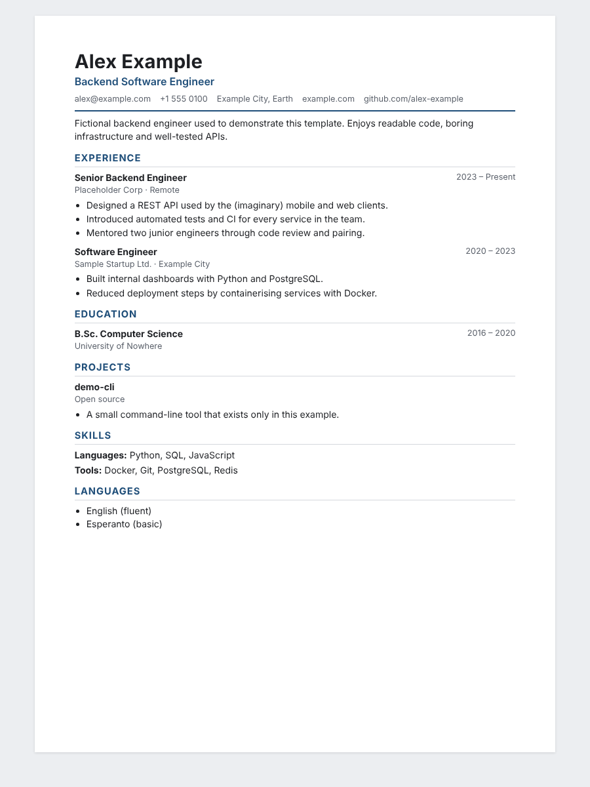
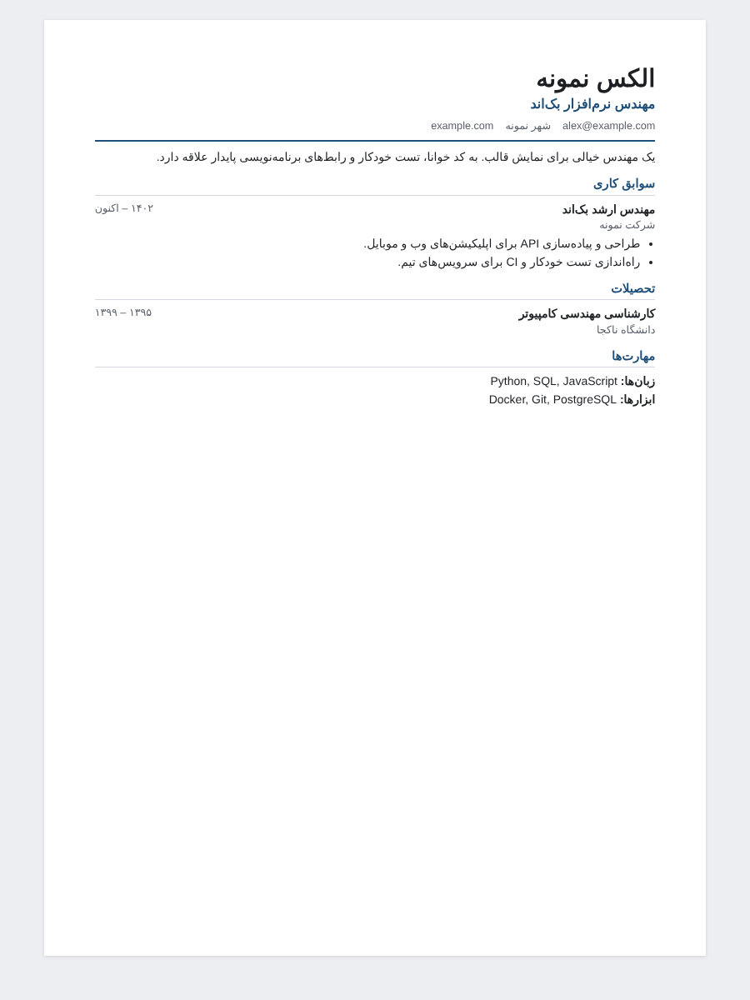

# resume-template

Write your resume once in **YAML**, render it to a clean, **ATS-friendly**, print-ready
**HTML** page (A4) and to **Markdown** with one small Python script. Right-to-left layout
for Persian resumes is a single switch.



The example person, **Alex Example**, is fictional; every detail in `resume.yaml` is made up.

## Why

- Resume content lives in plain text, so it diffs nicely in Git.
- Output is a single self-contained HTML file (CSS inlined) — open it, print it, or save as PDF.
- ATS-friendly: one column, real text, semantic headings, no tables, no images, no icons.
- No template engine: the renderer uses `string.Template` and plain functions; the only
  dependency is PyYAML.

## Features

- A4 page with `@page` rules and an `@media print` stylesheet (browser "Print → Save as PDF"
  gives a one-page PDF for the example).
- Three section types: `entries` (jobs, education, projects), `tags` (skill groups) and `list`.
- RTL mode: `meta.direction: rtl` in YAML or `--rtl` on the command line sets `dir="rtl"`
  and loads the [Vazirmatn](https://github.com/rastikerdar/vazirmatn) font from Google Fonts
  (falls back to Tahoma/Arial when offline).
- All text is HTML-escaped; schema errors are reported with a clear message.
- Markdown output for GitHub profiles, job boards or plain-text applications.

| LTR (`resume.yaml`) | RTL (`examples/resume-fa.yaml`) |
| --- | --- |
|  |  |

An example PDF produced from the HTML is in [`docs/resume-example.pdf`](docs/resume-example.pdf).

## Install

```bash
git clone https://github.com/ariaesm/resume-template.git
cd resume-template
python3 -m pip install -r requirements.txt
```

## Usage

```bash
$ python3 render_resume.py                 # renders resume.yaml into out/
wrote out/resume.html
wrote out/resume.md

$ python3 render_resume.py examples/resume-fa.yaml
wrote out/resume-fa.html
wrote out/resume-fa.md
```

Options:

```
python3 render_resume.py [resume.yaml] [-o OUT_DIR] [--rtl | --ltr] [--css custom.css]
```

### YAML schema

```yaml
meta:
  lang: en            # <html lang>
  direction: ltr      # ltr | rtl
basics:
  name: Alex Example  # required
  label: Backend Software Engineer
  email: alex@example.com
  phone: "+1 555 0100"
  location: Example City, Earth
  links: [{label: example.com, url: https://example.com}]
  summary: One short paragraph.
sections:
  - title: Experience
    type: entries      # entries | tags | list
    items:
      - {heading: Job title, subheading: Company, location: Remote,
         date: 2023 – Present, url: optional, bullets: [What you did.]}
  - title: Skills
    type: tags
    items: [{label: Languages, values: [Python, SQL]}]
  - title: Languages
    type: list
    items: [English (fluent)]
```

### PDF and screenshots

Use the browser's print dialog, or regenerate the files in `docs/` with Playwright
(Node.js, Chromium):

```bash
python3 render_resume.py && python3 render_resume.py examples/resume-fa.yaml
node scripts/snapshot.js
```

## Tests

```bash
python3 -m pip install pytest
python3 -m pytest
```

The suite checks HTML structure and print rules, RTL output, escaping, Markdown output,
schema validation and the CLI. CI (GitHub Actions) runs `ruff` and `pytest` on Python 3.12.

## License

[MIT](LICENSE) © 2026 Aria Esmaeilzadeh
